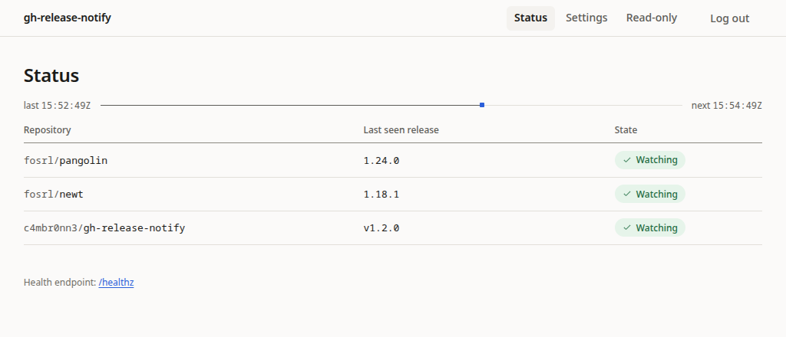

# gh-release-notify

[](https://github.com/c4mbr0nn3/gh-release-notify/releases)
[](LICENSE)
[](Cargo.toml)
[](https://github.com/c4mbr0nn3/gh-release-notify/pkgs/container/gh-release-notify)

A long-running Rust daemon that watches GitHub repos for new **stable** releases
and emails you when one appears. Ships as a Docker/podman container with an
embedded web UI for status and configuration.



[Quick start](#quick-start) · [Configuration](docs/configuration.md) · [Web UI & auth](docs/web-ui.md) · [Operations](docs/operations.md) · [Releases](docs/releases.md) · [Contributing](CONTRIBUTING.md)

## Quick start

```bash
git clone https://github.com/c4mbr0nn3/gh-release-notify.git
cd gh-release-notify
mkdir -p config state
cp config.example.toml config/config.toml
cp .env.example .env
# Edit config/config.toml (repos, recipients, SMTP) and .env (ADMIN_TOKEN,
# SMTP_PASSWORD) now, before the chown makes them container-owned.
sudo chown -R 10001:10001 config state      # the container runs as uid 10001
docker compose up -d
```

Open <http://127.0.0.1:8080>. With podman, replace the last command with
`podman compose up -d`. The first poll records each repo's current tag without
emailing, so a fresh deployment does not notify you about releases you already
have.

> [!WARNING]
> The UI can rewrite the config file, including the SMTP password. Set
> `ADMIN_TOKEN` (or `ui.trust_proxy_auth` behind a trusted proxy) before
> exposing the port.

## What it does

- Polls `GET /repos/{owner}/{repo}/releases/latest` on a fixed interval or a
  UTC cron schedule.
- Compares the latest stable tag to the last-seen tag in a JSON state file.
- Sends repo, tag, name, published date, URL, and release notes as plain text.
- Keeps state untouched on SMTP failure, so the email retries next tick.
- Records the current tag on first run without emailing.
- Shows live status and edits the config through the embedded web UI.

## Configuration

Minimal `config/config.toml`:

```toml
poll_interval_seconds = 3600
state_path = "/state/state.json"
sender = "gh-release-notify@homelab.local"
repos = ["fosrl/pangolin", "fosrl/newt"]
recipients = ["you@example.com"]
# cron_expression = "0 */6 * * *"          # optional; overrides the interval

[smtp]
host = "smtp.example.com"
port = 587
encryption = "starttls"                    # starttls | tls | none
username = "postmaster@example.com"
password = "changeme"                      # prefer SMTP_PASSWORD

[ui]
admin_token = ""                           # prefer ADMIN_TOKEN
trust_proxy_auth = false
```

`poll_interval_seconds` is required and must be at least 60. See
[Configuration](docs/configuration.md) for every key, the environment-variable
table, and cron syntax.

## Web UI and auth

The UI listens on `127.0.0.1:8080` by default. Exactly one auth mode is active:

| Mode | Setup | Notes |
|---|---|---|
| Token | `ADMIN_TOKEN` or `[ui].admin_token` | Login form; 12-hour session cookie |
| Proxy | `[ui].trust_proxy_auth = true` | Accepts `Remote-User`; spoofable if the port is directly reachable |
| Open | neither set | Anyone who can reach the port can edit config |

Setting a token and `trust_proxy_auth = true` together is a startup error.
Config edits from the UI apply to the running scheduler without a restart.
See [Web UI & auth](docs/web-ui.md) for reverse-proxy and read-only mount
recipes.

## Operations

- Health: `GET /healthz` returns JSON and needs no auth.
- Logs: structured `tracing`; set `RUST_LOG` (default `info`).
- State: delete `state.json` to reset the first-run behavior.
- State directory: must be writable by uid 10001 (`sudo chown 10001:10001 state`).
- Full log examples, permissions, upgrade steps, and troubleshooting:
  [Operations](docs/operations.md).

## Releases

Stable releases are cut locally with `./scripts/release.sh`; the tag push builds
and publishes amd64 + arm64 images to `ghcr.io/c4mbr0nn3/gh-release-notify` and
creates a GitHub Release. Release candidates use `./scripts/release-rc.sh`.
See [Releases](docs/releases.md) for the full flow, image tags, and rules.

## Documentation

| Document | Contents |
|---|---|
| [Configuration](docs/configuration.md) | Config keys, environment variables, cron |
| [Web UI & auth](docs/web-ui.md) | UI sections, auth modes, reverse proxy, read-only mounts |
| [UI guidelines](docs/UI-GUIDELINES.md) | Binding design contract for all UI work |
| [Operations](docs/operations.md) | Logs, state, permissions, upgrade, troubleshooting |
| [Architecture](docs/architecture.md) | Module map, data flow, runtime reload |
| [Releases](docs/releases.md) | Stable/RC flow, workflow, image tags |
| [Contributing](CONTRIBUTING.md) | Local build, verification gate, code rules |

## License

[MIT](LICENSE).
